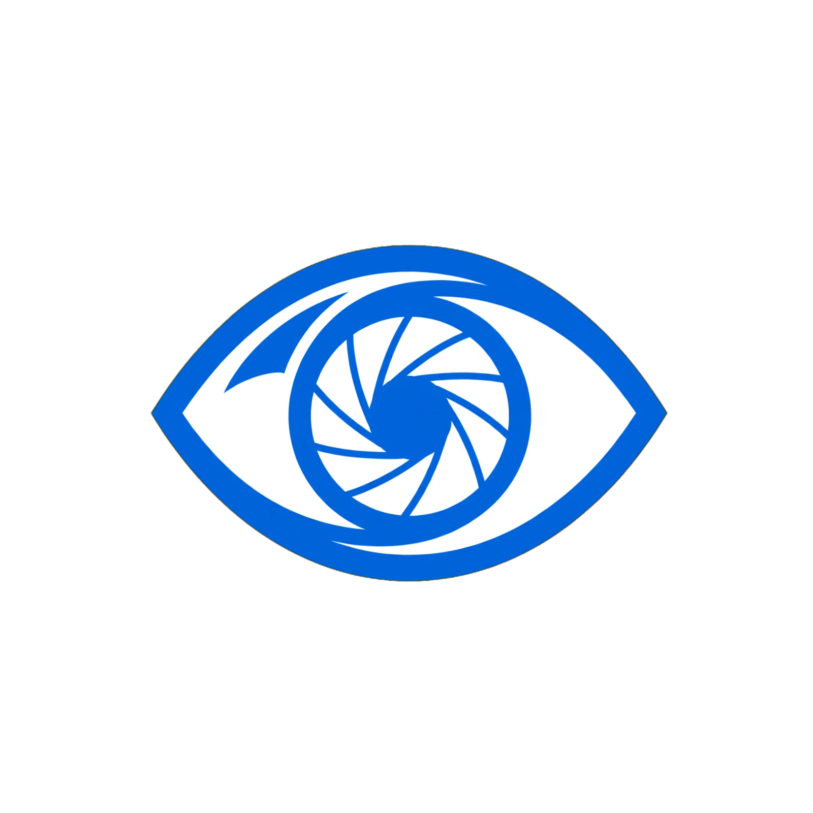
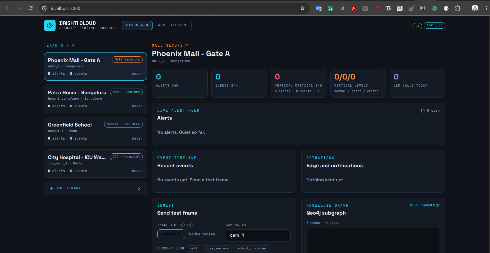
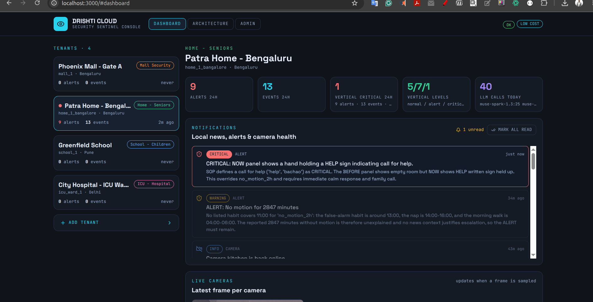
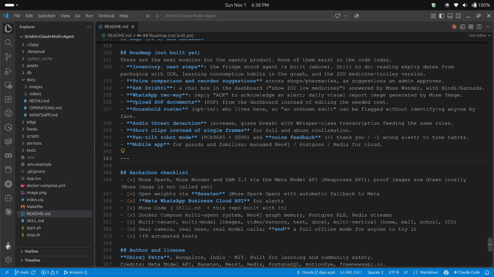
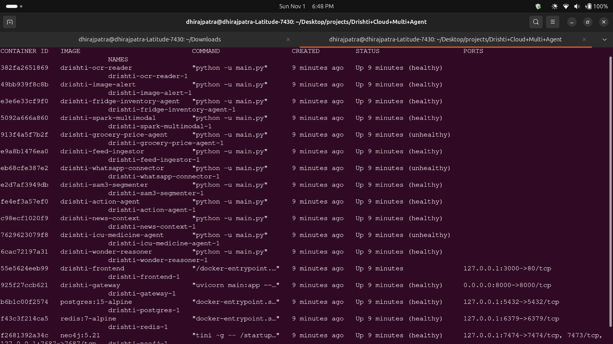
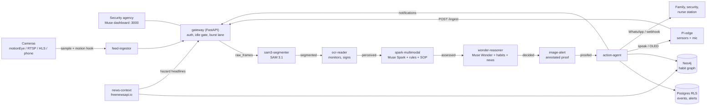

<p align="center">
  
</p>
# Drishti Cloud - Muse App for Security Agencies

> **Personal security superintelligence that watches your world, so you don't have to.**
> One dashboard for a security agency's clients: mall, home seniors, school, ICU. It sees every camera, remembers what is normal for each site, and speaks up fast on WhatsApp and on the spot when something is wrong.

> Powered by Meta: **`sam-3.1`** sees, **`muse-spark-1.3`** understands images + sensors + text + the site's written SOP, **`muse-wonder-1.0`** reasons over each site's habit graph (Neo4j) and local news, and the **WhatsApp Business Cloud API** acts.

> **Meta Global AI Developer Hackathon 2026** · Indie Track · *Build for Your World + Push the Frontier*

 
 
 
  







### 🎥 2-minute demo
**Video:** `<add YouTube link here>` - kitchen camera (motionEye) → fall alert with proof picture → Neo4j habit graph → switch to mall and ICU tenants.
No video handy? Run the [two-minute quick start](#try-it-in-two-minutes-no-keys-no-camera) below: the built-in simulator raises one hazard per vertical.

---

## Why a "Muse App"?

The Muse idea is a personal AI that **sees what you see, knows your world and acts for you**. Drishti applies it to a security agency owner who cannot watch every screen:

| Muse idea | What Drishti does today |
|---|---|
| **Sees what you see** | Any camera that gives snapshots, MJPEG, RTSP, HLS or MP4 (motionEye, ESP32-CAM, phone, CCTV). `sam-3.1` segments each frame into objects (person, bag, stove, bed, violence, fire, weapon...). |
| **Knows your world** | A Neo4j habit graph per site: "Dad naps 14:00-16:00", "cleaning crew parks trolleys 06:00-07:00". A known habit downgrades a matching alert; *False alarm* in the dashboard teaches a new habit. |
| **Reads your docs** | Each vertical has a written SOP (stored in Postgres, editable) that `muse-spark-1.3` reads together with the picture and cites in its rationale. |
| **Acts for you** | Spoken line on the edge speaker, OLED text, loud ISD1820 module, **WhatsApp Cloud API** messages, Slack-style webhook fallback, dashboard notifications. |
| **Never sleeps** | A deterministic rule engine runs on every frame, even when the API is down or the daily budget is used up. |

*Built to scale:* every agent is stateless with a per-tenant Redis stream, so more cameras and clients means `docker compose up --scale`. It has been run with a few tenants and cameras, not yet load-tested at 100 feeds.

---

## For reviewers: 60-second summary

| | |
|---|---|
| **Problem** | One guard watches 20 CCTV screens and misses almost everything. A senior alone at home, a child at a school gate, a patient in an ICU bed: nobody is watching continuously. |
| **What Drishti does** | Turns any ordinary camera into a vigilant assistant for **home seniors, schools, malls and ICU wards**: falls, physical abuse and fights, unattended bags, strangers, patient out of bed, monitor alarms, stove left on, and more. |
| **What is different** | (1) **Six cooperating agents** on a Redis bus, not one prompt. (2) **A per-site memory** (Neo4j habit graph) so "Dad naps at 3 pm" is not an alarm. (3) **World context**: local news can raise an alert's severity. (4) **Cost discipline**: the model is called only when the picture meaningfully changes, so it runs on a hobby budget. |
| **Meta technology used** | Muse Spark (vision + decisions), Muse Wonder (reasoning over memory and news), SAM 3.1 (segmentation), Meta Responses API, **Muse Spark Open on Baseten** (hackathon credits, with automatic fallback), **WhatsApp Business Cloud API** (alerts), built and extended with **Muse Code** (`SKILL.md`). |
| **Runs how** | `docker compose up -d` on a laptop today, the same file on any cloud later. **No API key needed to try it**: it starts in an offline `MOCK_MODE` with a built-in simulator. |
| **Verified** | 149 automated tests (whole six-agent pipeline end to end, in mock mode, plus gateway, cost-control, news, Baseten routing, WhatsApp, motion hook). Also running against a real motionEye camera, Meta Responses API, Neo4j and freenewsapi.io. |

### Try it in two minutes (no keys, no camera)
```bash
git clone https://github.com/dhirajpatra/Drishti-Cloud.git && cd Drishti-Cloud
cp .env.example .env                  # leave LLAMA_API_KEY empty -> MOCK_MODE=auto
echo "COMPOSE_PROFILES=sim" >> .env   # built-in simulator sends a hazard per vertical
docker compose up -d --build
open http://localhost:3000            # dashboard: alerts, live cameras, event timeline, notifications, knowledge graph
```
Within a minute the dashboard shows a fall (home), an unattended bag and a fight (mall), a stranger without a badge (school) and a
monitor alarm (ICU), each with an annotated proof picture and the spoken line the Pi speaker would say.

---

## What it can do

### Understands the scene (perception)
- **Multi-modal fusion**: camera frame **+** SAM 3.1 segmentation masks **+** sensors (PIR, ultrasonic, gesture, temperature) **+** text (OCR of an
  ICU monitor, a gate sign, a speech transcript) **+** the vertical's written safety **SOP**. Muse Spark reads all of it together and answers
  `NORMAL / ALERT / CRITICAL` with a one-line reason and a rationale that cites the SOP.
- **Rule engine in front of the model**: deterministic rules (no motion for 2 h, door open at night, bag alone for 2 min, crowd over 50, staff
  absent 1 h, vitals out of range...) run on every frame and keep protecting people **even if the API is down or the daily budget is used up**.

### Knows what is normal here (memory)
- **Neo4j habit graph** per tenant: people, habits, cameras, events, alerts. A known habit ("evening tea in the kitchen 17:00-18:00")
  downgrades a matching alert. **"False alarm" in the dashboard teaches the system a new habit.**
- **Local-news awareness**: the news agent finds headlines about the city the cameras are in (tenant location, e.g. Bengaluru/Bangalore),
  keeps the top 5, and Muse Wonder may **escalate an ALERT to CRITICAL** when the news makes it more dangerous (bomb threat + unattended bag).

### Reacts immediately (action)
- **Physical abuse / fights are an instant CRITICAL in every vertical** (home, mall, school, ICU): hitting, slapping, kicking, shoving,
  choking, dragging. Triggered by the model's judgement, a segmentation label, or words heard ("stop hitting me", "mat maro"). Habits can never suppress it.
- **Voice-first on the edge**: speaker (PAM8403 + 5 W woofer), loud ISD1820 module, OLED "FALL!" via a command queue the Pi polls.
- **Messages**: **WhatsApp Business Cloud API (Meta)** to family / security / admin / nurse station, with a Slack-compatible webhook as fallback.
- **Dashboard notification centre**: local-news hazards (flood, power cut, bomb threat, stampede...) and every confirmed alert, unread counts,
  tab-title badge.
- **Annotated proof image** on every alert, kept for review. It is drawn locally (boxes and labels), so it costs no model call.

### Keeps the kitchen stocked (fridge stock) *new*
Point a camera **inside the fridge** and Drishti keeps a list of everyday food: milk, eggs, bread, butter, cheese, curd, vegetables, fruits, juice
(add anything else from the Stock panel, with your own minimum and expiry date).
- **One click setup**: *Stock* panel, pick the camera, **Track everyday food**. **Scan fridge now** looks immediately.
- **Needs-to-buy list + one notification** ("Need to buy: eggs, bread") whenever something is seen below its minimum.
- **Careful by design**: a closed or dark door changes nothing; an item the model is unsure about stays "not seen yet" instead of being counted as missing;
  stock is only ever *lowered* by a confident look at the shelves.
- **Cheap**: it asks the vision model only when the picture changed (door opened, shopping put away), at most every `INVENTORY_SCAN_SEC` (10 min),
  and re-checks an unchanged picture every `INVENTORY_REFRESH_SEC` (6 h). Scan-now skips the wait.
- **Honest limits**: food hidden behind other food can read as missing, so the notification says "check before ordering". It counts from the camera's
  view only; it does not read expiry dates from packaging (enter them by hand) and it does not place orders.
- Try it: open the door, make sure *Live cameras* shows the shelves, press **Scan fridge now**, close the door when "Fridge checked" appears.
  Logs: `docker compose logs -f fridge-inventory-agent`.

### Sees like a careful human, not like a still-photo classifier
A guard does not judge one frozen picture. Drishti copies what a guard actually does:

| A human guard... | Drishti |
|---|---|
| **Watches for a few seconds** before judging a fall or a hit | On a motion-hook event the ingestor grabs a short burst; Spark receives a **storyboard** (BEFORE / earlier moments / NOW, labelled, in one image) and judges *movement*: standing to lying, a raised arm then contact, someone entering. |
| Compares **before and now** | Every analysed frame is shown next to the last analysed picture of that camera. |
| **Leans in** to read a monitor or sign | OCR reads **crops of the monitor / sign from a hi-res copy** (up to 1280x960), not a 640x480 blur. |
| Notices the **picture itself** is bad | Local quality check: **camera covered / blacked out** raises one `camera_obstructed` alert (and a "view is back" notice); a **silent camera** raises a notification after `CAMERA_OFFLINE_SEC`. |
| Is careful in the **dark** | Dim scenes are brightened with a deterministic contrast/gamma step (never a generative model, which could invent people) and Spark is told the picture is unreliable, so it prefers ALERT over CRITICAL unless clear. |
| Knows the **universal emergencies** | Fire / smoke, a weapon, physical abuse, a person collapsed or convulsing are handled in **every** vertical, plus vertical-specific ones (patient pulling lines, fence climbing, stampede...). |
| Keeps calm and **escalates in two steps** | Fast rules and Spark first; Muse Wonder adds habits and local news before confirming, suppressing or escalating. |

### Costs almost nothing to run (the hackathon-grade engineering)
| Mechanism | What it does |
|---|---|
| **Idle gate** | Every sampled frame is compared **locally** with the last analysed one on a 32x24 grid, brightness removed (lamps and auto-exposure do not count). Unchanged scene = **no model call**, last assessment reused. |
| **Burst lane** | A sudden big change (fight, fall, panic) skips the long wait and is analysed within `BURST_GAP_SEC`. |
| **Motion web hook** | motionEye calls Drishti the moment it sees motion; the frame is analysed immediately (cooldown-guarded). |
| **Thinking budget** | Muse models "think" before answering; effort and headroom are capped so tokens go to answers, not hidden reasoning. |
| **Daily caps** | Atomic per-provider counters (`MAX_LLM_CALLS_PER_DAY`, `MAX_BASETEN_CALLS_PER_DAY`); after the cap the rule engine keeps working. |
| **Provider chain** | `SPARK_MODEL=baseten:meta-models/muse-spark-open-1026\|muse-spark-1.3`: Baseten credits first, Meta as automatic fallback. |

Real usage numbers for your own deployment are at `GET /usage` and in the dashboard usage tile (calls and tokens per model, per provider).

### Built to be operated
- **Multi-tenant by design**: Postgres **row-level security** (forced), Neo4j `tenant_id` on every node, a Redis stream **per tenant per stage** with
  fair round-robin consumption, per-tenant API keys, optional admin token, per-tenant rate limit.
- **Connect more cameras from the dashboard** (mall gates, school corridors, ICU beds, rooms): snapshot / MJPEG, RTSP, HLS `.m3u8`, MP4.
- **Resilient**: dead-letter queues after retries, graceful degradation to rules, circuit breaker for a misbehaving model, health checks on every service.
- **Scales**: every agent is stateless: `docker compose up -d --scale spark-multimodal=3`.

---

## Architecture



The model providers behind `SAM`, `OCR`, `Spark` and `Wonder`: **Meta Responses API** (`https://api.meta.ai/v1/responses`) and/or **Baseten** (see [Models](#models-and-providers)).

| Service | Role |
|---|---|
| **gateway** | FastAPI. Validates tenants, resizes frames, runs the idle gate, serves the dashboard API, the motion hook and the Pi command queue. |
| **feed-ingestor** | Samples every camera, executes motion-hook triggers, includes cameras added from the dashboard. |
| **sam3-segmenter** | Objects with boxes (person, bag, stove, bed, violence...). Falls back from `sam-3.1` to the Spark vision model if SAM returns nothing. |
| **ocr-reader** | Reads ICU monitors, gate signs, notices. Runs only when a text-bearing object is in view (or ICU). |
| **spark-multimodal** | Fuses image, masks, sensors, OCR, audio and SOP; merges rule-engine findings with the model's judgement. |
| **wonder-reasoner** | Uses the habit graph, recent events and local news to confirm, suppress or escalate. |
| **image-alert** | Draws the proof picture (red boxes, locally, no model call) and keeps a small snapshot of every analysed frame for the timeline. |
| **action-agent** | Persists events/alerts, de-duplicates by cooldown, chooses actuations per vertical policy, sends WhatsApp, writes dashboard notifications. |
| **news-context** | Timer-driven: local headlines per tenant city into the graph; raises hazard notifications. |
| **frontend** | Live cameras, alert feed with proof pictures, event timeline with pictures, notifications, camera sources, knowledge graph, usage. |
| **neo4j / postgres / redis** | Memory graph / system of record with RLS / per-tenant streams, frames, caches. |
| **pi-edge-simulator** | Offline demo traffic (`COMPOSE_PROFILES=sim`, only in mock mode). |

---

## Verticals

| Vertical | What it catches | Typical response |
|---|---|---|
| **Home - seniors** | Fall, **physical abuse**, medical distress (clutching chest, convulsing), fire / smoke, weapon, no motion 2 h, door open at night, stove on and nobody there, spoken "help / bachao" | Calm spoken line, OLED, loud module, WhatsApp to family |
| **Mall** | **Physical abuse / fight**, weapon, fire / smoke, stampede or panic, medical distress, unattended bag > 2 min, crowd > 50, restricted area | Speaker, WhatsApp to security |
| **School - children** | **Physical abuse**, weapon, fire / smoke, fence climbing, child leaving unescorted, stranger without badge (CRITICAL near children), child alone in corridor, gate open in class time, bullying cluster | Admin notification, speaker, WhatsApp |
| **ICU / hospital** | **Physical abuse**, patient pulling lines, seizure, patient on floor, out of bed, monitor ALARM or abnormal vitals (zoomed OCR of HR / SpO2), fire / smoke, no staff at bedside for 1 h | Nurse station + image proof |

Each vertical is a SOP document + a prompt file (`services/spark-multimodal/prompts/<vertical>.txt`) + a rule set. Adding a vertical is a data change, not a rewrite.

---

## Models and providers

| Role | Default | Notes |
|---|---|---|
| Segmentation | `sam-3.1` (Meta) | Auto-fallback to the Spark vision model for an hour if it returns no usable text (`SAM_MODE`). |
| Vision decision | `muse-spark-1.3` (Meta) | Or `baseten:meta-models/muse-spark-open-1026` first, Meta second. |
| Reasoning | `muse-wonder-1.0` (Meta) | Runs only for ALERTs; never lowers a CRITICAL. |
| Muse Image | not in the detection path | It **generates / edits** pictures (it does not analyse or segment them), and a generator can invent people or objects, so it is deliberately *not* used to "enhance" evidence. A good future use is a privacy-preserving illustrated alert card or daily report for WhatsApp. `scripts/probe_muse_image.py` shows what it returns on your key. |
| OCR | `muse-spark-1.3` or Baseten | |

`MODEL=a|b|c` tries each in order; missing key, exhausted daily budget, HTTP error or empty answer moves to the next. Baseten usage is counted
separately and visible in the dashboard usage tile. Check your Baseten key, slug and image input with `scripts/probe_baseten.py`.

---

## Quick start

### 1. Configure
```bash
cp .env.example .env     # every option is documented inline; everything is optional
```
Key settings (see `.env.example` for all):

| Setting | Purpose |
|---|---|
| `LLAMA_API_KEY`, `MOCK_MODE` | Meta Model API key. Leave the key empty and keep `MOCK_MODE=auto` to run offline in mock mode. |
| `BASETEN_API_KEY`, `SPARK_MODEL=baseten:...\|muse-spark-1.3` | Use the hackathon credits first, Meta as fallback. |
| `RTSP_FEEDS=tenant:vertical:camera=url` | Cameras (e.g. `home_1_bangalore:home_seniors:kitchen=http://192.168.1.4:8081/`). |
| `SAMPLE_INTERVAL_SEC`, `CHANGE_FRACTION`, `MIN_ANALYSIS_GAP_SEC`, `BURST_*` | Idle gate and burst lane. |
| `MOTION_HOOK_TOKEN`, `GATEWAY_BIND_ADDR` | motionEye web hook. |
| `NEWS_API_KEY`, `NEWS_COUNTRY`, `NEWS_SCAN_PAGES` | Local news (freenewsapi.io). |
| `WHATSAPP_TOKEN`, `WHATSAPP_PHONE_ID`, `WHATSAPP_TO` | WhatsApp alerts. |
| `AUTH_REQUIRED`, `ADMIN_TOKEN`, `BIND_ADDR` | Security for anything beyond your laptop. |

### 2. Run
```bash
docker compose up -d --build        # or ./start.sh
docker compose logs -f spark-multimodal feed-ingestor
```
Dashboard http://localhost:3000 · API http://localhost:8000/docs · Neo4j Browser http://localhost:7474.

### 3. Connect a real camera
- **motionEye** (works today): set `RTSP_FEEDS` to its streaming URL (port 8081) and recreate `feed-ingestor`.
- **Motion web hook** so Drishti analyses the moment motion is detected - in motionEye: *Motion Notifications -> Call A Web Hook* = ON, method **GET**, URL
  `http://<laptop-LAN-ip>:8000/hook/motion/<tenant>/<camera>?token=<MOTION_HOOK_TOKEN>`, with `GATEWAY_BIND_ADDR=0.0.0.0` so the camera can reach the gateway.
  `<camera>` must equal the camera id in `RTSP_FEEDS`. Test: `curl "http://localhost:8000/hook/motion/home_1_bangalore/kitchen?token=..."` returns `{"status":"triggered"}`;
  the ingestor log then shows `motion hook -> analysing now`. One analysis per camera per `MOTION_HOOK_COOLDOWN_SEC` (60), so a busy room cannot burn your budget.
- **More cameras**: dashboard panel *Camera sources*, or `POST /tenants/{id}/feeds {"camera_id":"bedroom","url":"rtsp://..."}`.
- **Facebook / Instagram Live**: not supported, deliberately. Meta's Live Video API only lets an app *create and push* a broadcast; there is no API to read someone
  else's stream, and scraping would break Meta's terms. Use the camera's own RTSP/HTTP/HLS URL, or restream your camera yourself.

### 4. WhatsApp alerts (Meta WhatsApp Business Cloud API)
Free step-by-step setup with Meta's test number, the 24-hour rule and error fixes: **[docs/WHATSAPP.md](./docs/WHATSAPP.md)**.
Set `WHATSAPP_TOKEN`, `WHATSAPP_PHONE_ID`, `WHATSAPP_TO`. Free text only reaches a number that messaged your business number in the last 24 h; for real
alerts create an approved template with one body variable and set `WHATSAPP_TEMPLATE`.

### 5. Send a test frame by hand
```bash
curl -X POST http://localhost:8000/ingest/mall_1 -F "file=@photo.jpg" -F "camera_id=door_cam" -F "force=true" \
  -F 'sensors={"pir":true,"us_front":75}'
# {"status":"queued","frame_id":"...","static":false,"change":null}
```

### 6. Tests (no Docker, no key, no Neo4j needed)
```bash
pip install ./services/common fastapi "uvicorn[standard]" python-multipart pytest
make test      # throw-away redis + postgres, whole pipeline in MOCK_MODE: 149 tests
make smoke     # against a running stack: one hazard per vertical must raise the right alert
```

---

## Dashboard tour
The dashboard uses a Meta Muse-style look: light and airy with Meta blue by default, a dark mode with the sun/moon button, and your choice is remembered.
0a. **Stock panel**: *Need to buy* list, **Track everyday food**, **Scan fridge now**, and the full stock table with minimums and expiry (see "Keeps the kitchen stocked").
0. **Admin tab**: pick a site or a single camera (kitchen, mall gate...) and set everything in the browser, saved to the database and applied by every agent within seconds, no `.env` edit or restart: camera **IP / port / path / username / password** (password encrypted, write-only, with a *Test connection* button that shows a live preview), which **alarms** are on, their level, repeat time and active hours, **limits** (crowd size, unattended-bag time, night hours...), **custom watch rules in plain English** plus exact **object rules** ("person absent for 10 min"), who gets **WhatsApp / webhook** messages and what each level triggers, how often to look and how sensitive to change, and the site's SOP. Defaults come from code/`.env`; the page shows what is customised and can reset it. Set `AUTH_REQUIRED=true` and `SECRETS_KEY` before exposing it.
1. **Notifications**: local-news hazards and confirmed alerts, unread badge, click to mark read.
2. **Live cameras**: newest frame per camera, stale warning if a camera goes quiet.
3. **Camera sources**: connect another room, gate or ward in one line.
4. **Alert feed**: proof picture, why it fired, objects, actions taken, *Acknowledge* and *False alarm* (teaches a habit).
5. **Event timeline**: every analysed frame with its picture and reason, including NORMAL ones.
6. **Knowledge graph** and **usage** (model calls and tokens per model, per provider).

Deep dives: **[WhatsApp setup](./docs/WHATSAPP.md)** · **[Neo4j queries](./docs/NEO4J.md)** · **[Operations, cloud move, commands](./docs/OPERATIONS.md)** · **[Muse Code skill](./SKILL.md)**.

---

## API (selected)
`POST /ingest/{tenant}` · `GET|POST /tenants` · `GET /tenants/{id}/cameras` · `/cameras/{cam}/latest` · `GET|POST|DELETE /tenants/{id}/feeds` ·
`GET|POST /hook/motion/{tenant}/{camera}?token=` · `GET /tenants/{id}/alerts|events|graph|actuations` · `/events/{frame}/image` ·
`GET /tenants/{id}/notifications` · `POST /tenants/{id}/notifications/read` · `GET /alerts/{id}/image` · `POST /alerts/{id}/ack` ·
`GET /admin/overview` · `GET|PUT|DELETE /admin/tenants/{id}/config?camera=` · `GET|PUT|DELETE /admin/tenants/{id}/cameras/{cam}` · `POST .../cameras/{cam}/test` (admin token) · `GET /verticals/{v}/stats` · `GET /usage` · `GET /health` · `GET /edge/{tenant}/actuate` (Pi polls for speak / OLED commands).
Interactive docs at `/docs`.

---

## Business model (proposed)
Drishti targets **security agencies** that run monitoring for many small clients (homes, schools, malls, wards) and today pay guards to watch screens.
- Per-camera monthly subscription for 24x7 monitoring with proof pictures and WhatsApp alerts.
- Per-site running cost is about **Rs 60/month** of model API + **Rs 80** of electricity on the Pi edge (design target; see `GET /usage` for real numbers on your deployment).
- Pricing and add-on modules below are proposals, not yet validated with customers.

---

## How close is this to "human intelligence"? An honest answer
It is a vigilant assistant, not a human replacement. It is strong at *noticing and escalating fast* (24 x 7, never tired, consistent), and it now reasons over
sequences, context, memory and picture quality. It is still limited by what a camera at a sampled moment shows: no audio understanding yet, no identity, no
long video, and a vision model can be wrong. That is why every alert carries its reason and a proof picture, why *False alarm* teaches the system, and why a
person always confirms a life-critical situation.

---

## Security, privacy and honesty
- **Local-first**: everything binds to `127.0.0.1` by default; the one exception is the gateway if you set `GATEWAY_BIND_ADDR` for the motion hook. For anything shared:
  `AUTH_REQUIRED=true`, a long `ADMIN_TOKEN`, new database passwords, TLS in front.
- **Tenant isolation** at every layer (Postgres RLS, Neo4j filters, per-tenant streams and keys).
- **Credentials in camera URLs are masked** when listed; the motion hook has its own secret token and a cooldown.
- **No face recognition.** Drishti does not know *who* a person is, only what they are doing (it can recognise roles such as staff or badge). Identifying
  individuals would need explicit consent and a privacy design; it is on the roadmap as an opt-in household roster.
- **Decision support, not a guarantee.** A single still frame cannot prove abuse or a fall: expect false alarms (that is what *False alarm* and the habit
  graph are for), and a short event can fall between samples unless you sample often (cheap with the idle gate) or use the motion hook. Never rely on it as the only safeguard for a life-critical situation.
- Hardware wiring note: an HC-SR04 echo pin needs the 1 k / 2 k divider to 3.3 V, or it will damage the Pi.

---

## Edge (Pi 5) and hardware
`edge/pi_edge.py` reads the sensors (PIR, 2x HC-SR04 with divider, IR obstacle, DHT11, APDS-9960), grabs a frame and posts it to the gateway; it polls
`/edge/{tenant}/actuate` to speak through a PAM8403 amp and 2" 5 W woofer, sound the ISD1820 module and draw on a 0.96" SSD1306 OLED. The edge script has not
been verified on real Pi hardware; the camera path in use today is motionEye over HTTP.
```bash
cd edge && pip install -r requirements.txt
python pi_edge.py --tenant_id home_1_bangalore --vertical home_seniors --gateway http://YOUR_CLOUD_IP:8000
```

---

## Roadmap (not built yet)
These are the next modules for the agency product. None of them exist in the code today.
- **Inventory, next steps**: the fridge stock agent is built (above). Still to do: reading expiry dates from packaging with OCR, learning consumption habits in the graph, and the ICU medicine-trolley version.
- **Price comparison and reorder suggestions** across shops/pharmacies, as suggestions an admin approves.
- **Ask Drishti**: a chat box in the dashboard ("show ICU low medicines") answered by Muse Wonder, with Hindi/Kannada.
- **WhatsApp two-way**: reply "ACK" to acknowledge an alert; daily visual report image generated by Muse Image.
- **Upload SOP documents** (PDF) from the dashboard instead of editing the seeded text.
- **Household roster** (opt-in): who lives here, so "an unknown adult" can be flagged without identifying anyone by face.
- **Audio threat detection** (screams, glass break) with Whisper-class transcription feeding the same rules.
- **Short clips instead of single frames** for fall and abuse confirmation.
- **Pan-tilt robot mode** (PCA9685 + SG90) and **voice feedback** (+1 thank you / -1 wrong alert) to tune habits.
- **Mobile app** for guards and families; managed Neo4j / Postgres / Redis for cloud.

---

## Hackathon checklist
- [x] Muse Spark, Muse Wonder and SAM 3.1 via the Meta Model API (Responses API); proof images are drawn locally (Muse Image is not called yet)
- [x] Open weights via **Baseten** (Muse Spark Open) with automatic fallback to Meta
- [x] **Meta WhatsApp Business Cloud API** for alerts
- [x] Muse Code (`SKILL.md` + this repo built with it)
- [x] Docker Compose multi-agent system, Neo4j graph memory, Postgres RLS, Redis streams
- [x] Multi-tenant, multi-modal (images, video/sensors, text, docs), multi-vertical (home, mall, school, ICU)
- [x] Real camera, real news, real model calls; **and** a full offline mode for anyone to try it
- [x] 149 automated tests

## Author and license
**Dhiraj Patra**, Bangalore, India · MIT. Built for learning and community safety.
Credits: Meta Model API, Baseten, Neo4j, Redis, PostgreSQL, motionEye, freenewsapi.io.

> "One Pi watches home, 1000 Pis watch World."
