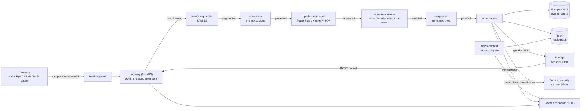

# Drishti Cloud

**A multi-agent, multi-tenant, multi-modal safety platform that watches a camera the way a caring person would: it understands the
scene, remembers what is normal for *this* home, school, mall or ICU, and speaks up fast when something is wrong.**

> **Meta Global AI Developer Hackathon 2026** · Indie Track · *Build for Your World + Push the Frontier*

 
 
 
  


---

## For reviewers: 60-second summary

| | |
|---|---|
| **Problem** | One guard watches 20 CCTV screens and misses almost everything. A senior alone at home, a child at a school gate, a patient in an ICU bed: nobody is watching continuously. |
| **What Drishti does** | Turns any ordinary camera (motionEye, RTSP, phone, ESP32-CAM) into a vigilant assistant for **home seniors, schools, malls and ICU wards**: falls, physical abuse and fights, unattended bags, strangers, patient out of bed, monitor alarms, stove left on, and more. |
| **What is different** | (1) **Six cooperating agents** on a Redis bus, not one prompt. (2) **A per-site memory** (Neo4j habit graph) so "Dad naps at 3 pm" is not an alarm. (3) **World context**: local news can raise an alert's severity. (4) **Cost discipline**: the model is called only when the picture meaningfully changes, so it runs on a hobby budget. |
| **Meta technology used** | Muse Spark (vision + decisions), Muse Wonder (reasoning over memory and news), SAM 3.1 (segmentation), Muse Image (annotated proof), Meta Responses API, **Muse Spark Open on Baseten** (hackathon credits, with automatic fallback), **WhatsApp Business Cloud API** (alerts), built and extended with **Muse Code** (`SKILL.md`). |
| **Runs how** | `docker compose up -d` on a laptop today, the same file on any cloud later. **No API key needed to try it**: it starts in an offline `MOCK_MODE` with a built-in simulator. |
| **Verified** | 91 automated tests (whole six-agent pipeline end to end, in mock mode, plus gateway, cost-control, news, Baseten routing, WhatsApp, motion hook). Also running against a real motionEye camera, Meta Responses API, Neo4j and freenewsapi.io. |

### Try it in two minutes (no keys, no camera)
```bash
git clone https://github.com/dhirajpatra/Drishti-Cloud.git && cd Drishti-Cloud
cp .env.example .env                  # leave LLAMA_API_KEY empty -> MOCK_MODE
echo "COMPOSE_PROFILES=sim" >> .env   # built-in simulator sends a hazard per vertical
docker compose up -d --build
open http://localhost:3000            # dashboard: alerts, live cameras, event timeline, notifications, knowledge graph
```
Within a minute the dashboard shows a fall (home), an unattended bag and a fight (mall), a stranger without a badge (school) and a
monitor alarm (ICU), each with an annotated proof picture and the spoken line the Pi speaker would say.

---

## What it can do

### Understands the scene (perception)
- **Multi-modal fusion**: camera frame **+** SAM 3.1 segmentation masks **+** sensors (PIR, ultrasonic, gesture, temperature) **+** text (OCR of an
  ICU monitor, a gate sign, a speech transcript) **+** the vertical's written safety **SOP**. Muse Spark reads all of it together and answers
  `NORMAL / ALERT / CRITICAL` with a one-line reason and a rationale that cites the SOP.
- **Rule engine in front of the model**: deterministic rules (no motion for 2 h, door open at night, bag alone for 2 min, crowd over 50, staff
  absent 1 h, vitals out of range...) run on every frame and keep protecting people **even if the API is down or the daily budget is used up**.

### Knows what is normal here (memory)
- **Neo4j habit graph** per tenant: people, habits, cameras, events, alerts. A known habit ("evening tea in the kitchen 17:00-18:00")
  downgrades a matching alert. **"False alarm" in the dashboard teaches the system a new habit.**
- **Local-news awareness**: the news agent finds headlines about the city the cameras are in (tenant location, e.g. Bengaluru/Bangalore),
  keeps the top 5, and Muse Wonder may **escalate an ALERT to CRITICAL** when the news makes it more dangerous (bomb threat + unattended bag).

### Reacts immediately (action)
- **Physical abuse / fights are an instant CRITICAL in every vertical** (home, mall, school, ICU): hitting, slapping, kicking, shoving,
  choking, dragging. Triggered by the model's judgement, a segmentation label, or words heard ("stop hitting me", "mat maro"). Habits can never suppress it.
- **Voice-first on the edge**: speaker (PAM8403 + 5 W woofer), loud ISD1820 module, OLED "FALL!" via a command queue the Pi polls.
- **Messages**: **WhatsApp Business Cloud API (Meta)** to family / security / admin / nurse station, with a Slack-compatible webhook as fallback.
- **Dashboard notification centre**: local-news hazards (flood, power cut, bomb threat, stampede...) and every confirmed alert, unread counts,
  tab-title badge.
- **Annotated proof image** on every alert, kept for review.

### Costs almost nothing to run (the hackathon-grade engineering)
| Mechanism | What it does |
|---|---|
| **Idle gate** | Every sampled frame is compared **locally** with the last analysed one on a 32x24 grid, brightness removed (lamps and auto-exposure do not count). Unchanged scene = **no model call**, last assessment reused. |
| **Burst lane** | A sudden big change (fight, fall, panic) skips the long wait and is analysed within `BURST_GAP_SEC`. |
| **Motion web hook** | motionEye calls Drishti the moment it sees motion; the frame is analysed immediately (cooldown-guarded). |
| **Thinking budget** | Muse models "think" before answering; effort and headroom are capped so tokens go to answers, not hidden reasoning. |
| **Daily caps** | Atomic per-provider counters (`MAX_LLM_CALLS_PER_DAY`, `MAX_BASETEN_CALLS_PER_DAY`); after the cap the rule engine keeps working. |
| **Provider chain** | `SPARK_MODEL=baseten:meta-models/muse-spark-open-1026\|muse-spark-1.3`: Baseten credits first, Meta as automatic fallback. |

### Built to be operated
- **Multi-tenant by design**: Postgres **row-level security** (forced), Neo4j `tenant_id` on every node, a Redis stream **per tenant per stage** with
  fair round-robin consumption, per-tenant API keys, optional admin token, per-tenant rate limit.
- **Connect more cameras from the dashboard** (mall gates, school corridors, ICU beds, rooms): snapshot / MJPEG, RTSP, HLS `.m3u8`, MP4.
- **Resilient**: dead-letter queues after retries, graceful degradation to rules, circuit breaker for a misbehaving model, health checks on every service.
- **Scales**: every agent is stateless: `docker compose up -d --scale spark-multimodal=3`.

---

## Architecture



The model providers behind `SAM`, `OCR`, `Spark`, `Wonder` and `Image`: **Meta Responses API** and/or **Baseten** (see [Models](#models-and-providers)).

| Service | Role |
|---|---|
| **gateway** | FastAPI. Validates tenants, resizes frames, runs the idle gate, serves the dashboard API, the motion hook and the Pi command queue. |
| **feed-ingestor** | Samples every camera, executes motion-hook triggers, includes cameras added from the dashboard. |
| **sam3-segmenter** | Objects with boxes (person, bag, stove, bed, violence...). Falls back from `sam-3.1` to the Spark vision model if SAM returns nothing. |
| **ocr-reader** | Reads ICU monitors, gate signs, notices. Runs only when a text-bearing object is in view (or ICU). |
| **spark-multimodal** | Fuses image, masks, sensors, OCR, audio and SOP; merges rule-engine findings with the model's judgement. |
| **wonder-reasoner** | Uses the habit graph, recent events and local news to confirm, suppress or escalate. |
| **image-alert** | Draws the proof picture (red boxes) and keeps a small snapshot of every analysed frame for the timeline. |
| **action-agent** | Persists events/alerts, de-duplicates by cooldown, chooses actuations per vertical policy, sends WhatsApp, writes dashboard notifications. |
| **news-context** | Timer-driven: local headlines per tenant city into the graph; raises hazard notifications. |
| **frontend** | Live cameras, alert feed with proof pictures, event timeline with pictures, notifications, camera sources, knowledge graph, usage. |
| **neo4j / postgres / redis** | Memory graph / system of record with RLS / per-tenant streams, frames, caches. |
| **pi-edge-simulator** | Offline demo traffic (`COMPOSE_PROFILES=sim`, only in mock mode). |

---

## Verticals

| Vertical | What it catches | Typical response |
|---|---|---|
| **Home - seniors** | Fall, **physical abuse**, no motion 2 h, door open at night, stove on and nobody there, spoken "help / bachao" | Calm spoken line, OLED, loud module, WhatsApp to family |
| **Mall** | **Physical abuse / fight**, unattended bag > 2 min, crowd > 50, restricted area, panic | Speaker, WhatsApp to security |
| **School - children** | **Physical abuse**, stranger without badge (CRITICAL near children), child alone in corridor, gate open in class time, bullying cluster | Admin notification, speaker, WhatsApp |
| **ICU / hospital** | **Physical abuse**, patient on floor, out of bed, monitor ALARM or abnormal vitals (OCR of HR / SpO2), no staff at bedside for 1 h | Nurse station + image proof |

Each vertical is a SOP document + a prompt file (`services/spark-multimodal/prompts/<vertical>.txt`) + a rule set. Adding a vertical is a data change, not a rewrite.

---

## Models and providers

| Role | Default | Notes |
|---|---|---|
| Segmentation | `sam-3.1` (Meta) | Auto-fallback to the Spark vision model for an hour if it returns no usable text (`SAM_MODE`). |
| Vision decision | `muse-spark-1.3` (Meta) | Or `baseten:meta-models/muse-spark-open-1026` first, Meta second. |
| Reasoning | `muse-wonder-1.0` (Meta) | Runs only for ALERTs; never lowers a CRITICAL. |
| Proof image | `muse-image` (Meta) | Annotated proof with boxes. |
| OCR | `muse-spark-1.3` or Baseten | |

`MODEL=a|b|c` tries each in order; missing key, exhausted daily budget, HTTP error or empty answer moves to the next. Baseten usage is counted
separately and visible in the dashboard usage tile. Check your Baseten key, slug and image input with `scripts/probe_baseten.py`.

---

## Quick start

### 1. Configure
```bash
cp .env.example .env     # every option is documented inline; everything is optional
```
Key settings (see `.env.example` for all):

| Setting | Purpose |
|---|---|
| `LLAMA_API_KEY`, `MOCK_MODE=false` | Meta Model API key; leave the key empty to run offline in mock mode. |
| `BASETEN_API_KEY`, `SPARK_MODEL=baseten:...\|muse-spark-1.3` | Use the hackathon credits first, Meta as fallback. |
| `RTSP_FEEDS=tenant:vertical:camera=url` | Cameras (e.g. `home_1_bangalore:home_seniors:kitchen=http://192.168.1.4:8081/`). |
| `SAMPLE_INTERVAL_SEC`, `CHANGE_FRACTION`, `MIN_ANALYSIS_GAP_SEC`, `BURST_*` | Idle gate and burst lane. |
| `MOTION_HOOK_TOKEN`, `GATEWAY_BIND_ADDR` | motionEye web hook. |
| `NEWS_API_KEY`, `NEWS_COUNTRY`, `NEWS_SCAN_PAGES` | Local news (freenewsapi.io). |
| `WHATSAPP_TOKEN`, `WHATSAPP_PHONE_ID`, `WHATSAPP_TO` | WhatsApp alerts. |
| `AUTH_REQUIRED`, `ADMIN_TOKEN`, `BIND_ADDR` | Security for anything beyond your laptop. |

### 2. Run
```bash
docker compose up -d --build
docker compose logs -f spark-multimodal feed-ingestor
```
Dashboard http://localhost:3000 · API http://localhost:8000/docs · Neo4j Browser http://localhost:7474.

### 3. Connect a real camera
- **motionEye** (works today): set `RTSP_FEEDS` to its streaming URL (port 8081) and recreate `feed-ingestor`.
- **Motion web hook** so Drishti analyses the moment motion is detected - in motionEye: *Motion Notifications -> Call A Web Hook* = ON, method **GET**, URL
  `http://<laptop-LAN-ip>:8000/hook/motion/<tenant>/<camera>?token=<MOTION_HOOK_TOKEN>`, with `GATEWAY_BIND_ADDR=0.0.0.0` so the camera can reach the gateway.
  `<camera>` must equal the camera id in `RTSP_FEEDS`. Test: `curl "http://localhost:8000/hook/motion/home_1_bangalore/kitchen?token=..."` returns `{"status":"triggered"}`;
  the ingestor log then shows `motion hook -> analysing now`. One analysis per camera per `MOTION_HOOK_COOLDOWN_SEC` (60), so a busy room cannot burn your budget.
- **More cameras**: dashboard panel *Camera sources*, or `POST /tenants/{id}/feeds {"camera_id":"bedroom","url":"rtsp://..."}`.
- **Facebook / Instagram Live**: not supported, deliberately. Meta's Live Video API only lets an app *create and push* a broadcast; there is no API to read someone
  else's stream, and scraping would break Meta's terms. Use the camera's own RTSP/HTTP/HLS URL, or restream your camera yourself.

### 4. WhatsApp alerts (Meta WhatsApp Business Cloud API)
Set `WHATSAPP_TOKEN`, `WHATSAPP_PHONE_ID`, `WHATSAPP_TO`. Free text only reaches a number that messaged your business number in the last 24 h; for real
alerts create an approved template with one body variable and set `WHATSAPP_TEMPLATE`.

### 5. Send a test frame by hand
```bash
curl -X POST http://localhost:8000/ingest/mall_1 -F "file=@photo.jpg" -F "camera_id=door_cam" -F "force=true" \
  -F 'sensors={"pir":true,"us_front":75}'
# {"status":"queued","frame_id":"...","static":false,"change":null}
```

### 6. Tests (no Docker, no key, no Neo4j needed)
```bash
pip install ./services/common fastapi "uvicorn[standard]" python-multipart pytest
make test      # throw-away redis + postgres, whole pipeline in MOCK_MODE: 91 tests
make smoke     # against a running stack: one hazard per vertical must raise the right alert
```

---

## Dashboard tour
1. **Notifications**: local-news hazards and confirmed alerts, unread badge, click to mark read.
2. **Live cameras**: newest frame per camera, stale warning if a camera goes quiet.
3. **Camera sources**: connect another room, gate or ward in one line.
4. **Alert feed**: proof picture, why it fired, objects, actions taken, *Acknowledge* and *False alarm* (teaches a habit).
5. **Event timeline**: every analysed frame with its picture and reason, including NORMAL ones.
6. **Knowledge graph** and **usage** (model calls and tokens per model, per provider).

Deep dives: **[Neo4j queries](./docs/NEO4J.md)** · **[Operations, cloud move, commands](./docs/OPERATIONS.md)** · **[Muse Code skill](./SKILL.md)**.

---

## API (selected)
`POST /ingest/{tenant}` · `GET|POST /tenants` · `GET /tenants/{id}/cameras` · `/cameras/{cam}/latest` · `GET|POST|DELETE /tenants/{id}/feeds` ·
`GET|POST /hook/motion/{tenant}/{camera}?token=` · `GET /tenants/{id}/alerts|events|graph|actuations` · `/events/{frame}/image` ·
`GET /tenants/{id}/notifications` · `POST /tenants/{id}/notifications/read` · `GET /alerts/{id}/image` · `POST /alerts/{id}/ack` ·
`GET /verticals/{v}/stats` · `GET /usage` · `GET /health` · `GET /edge/{tenant}/actuate` (Pi polls for speak / OLED commands).
Interactive docs at `/docs`.

---

## Security, privacy and honesty
- **Local-first**: everything binds to `127.0.0.1` by default; the one exception is the gateway if you set `GATEWAY_BIND_ADDR` for the motion hook. For anything shared:
  `AUTH_REQUIRED=true`, a long `ADMIN_TOKEN`, new database passwords, TLS in front.
- **Tenant isolation** at every layer (Postgres RLS, Neo4j filters, per-tenant streams and keys).
- **Credentials in camera URLs are masked** when listed; the motion hook has its own secret token and a cooldown.
- **No face recognition.** Drishti does not know *who* a person is, only what they are doing (it can recognise roles such as staff or badge). Identifying
  individuals would need explicit consent and a privacy design; it is on the roadmap as an opt-in household roster.
- **Decision support, not a guarantee.** A single still frame cannot prove abuse or a fall: expect false alarms (that is what *False alarm* and the habit
  graph are for), and a short event can fall between samples unless you sample often (cheap with the idle gate) or use the motion hook. Never rely on it as the only safeguard for a life-critical situation.
- Hardware wiring note: an HC-SR04 echo pin needs the 1 k / 2 k divider to 3.3 V, or it will damage the Pi.

---

## Edge (Pi 5) and hardware
`edge/pi_edge.py` reads the sensors (PIR, 2x HC-SR04 with divider, IR obstacle, DHT11, APDS-9960), grabs a frame and posts it to the gateway; it polls
`/edge/{tenant}/actuate` to speak through a PAM8403 amp and 2" 5 W woofer, sound the ISD1820 module and draw on a 0.96" SSD1306 OLED. Per-site target:
about **Rs 60/month** of API + **Rs 80** of electricity.
```bash
cd edge && pip install -r requirements.txt
python pi_edge.py --tenant_id home_1_bangalore --vertical home_seniors --gateway http://YOUR_CLOUD_IP:8000
```

---

## Roadmap
- **Household roster** (opt-in): who lives here, so "an unknown adult" can be flagged without identifying anyone by face.
- **Audio threat detection** (screams, glass break) with Whisper-class transcription feeding the same rules.
- **Short clips instead of single frames** for fall and abuse confirmation.
- **Pan-tilt robot mode** (PCA9685 + SG90) and **voice feedback** (+1 thank you / -1 wrong alert) to tune habits.
- **Mobile app** for guards and families; managed Neo4j / Postgres / Redis for cloud.

---

## Hackathon checklist
- [x] Muse Spark, Muse Wonder, Muse Image and SAM 3.1 via the Meta Model API (Responses API)
- [x] Open weights via **Baseten** (Muse Spark Open) with automatic fallback to Meta
- [x] **Meta WhatsApp Business Cloud API** for alerts
- [x] Muse Code (`SKILL.md` + this repo built with it)
- [x] Docker Compose multi-agent system, Neo4j graph memory, Postgres RLS, Redis streams
- [x] Multi-tenant, multi-modal (images, video/sensors, text, docs), multi-vertical (home, mall, school, ICU)
- [x] Real camera, real news, real model calls; **and** a full offline mode for anyone to try it
- [x] 91 automated tests

## Author and license
**Dhiraj Patra**, Bangalore, India · MIT. Built for learning and community safety.
Credits: Meta Model API, Baseten, Neo4j, Redis, PostgreSQL, motionEye, freenewsapi.io.

> "One Pi watches home, 100 Pis watch Bharat."
